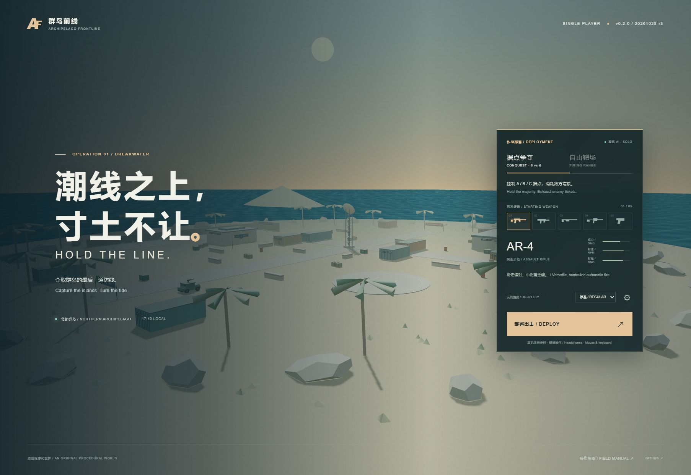

# 群岛前线 · Archipelago Frontline

潮线行动 / Operation Breakwater — v0.2.0

[在线试玩 / Play in your browser](https://garry-tang-274.github.io/battlefield-web-fps-prototype/) · [操作与运行 / Controls & setup](#开始游戏--start-playing) · [架构 / Architecture](docs/ARCHITECTURE.md) · [更新记录 / Changelog](CHANGELOG.md)

一个可以直接在浏览器运行的单人第一人称射击游戏。你与五名联军 AI 共同争夺海岛上的三个据点，对抗六名守军；也可以进入无来袭火力的靶场练习。

A single-player browser FPS. Join five allied AI soldiers against six defenders across three island objectives, or learn the weapons in a peaceful firing range.



## 这次升级 / The v0.2 upgrade

- **完整据点战：** 三个据点、争夺冻结、增援消耗、三档难度、死亡重部署、实时战况与结算。单局最长 8 分钟。
- **Complete conquest:** three objectives, contested captures, ticket bleed, three difficulties, redeployment, live scoreboard and match results. Matches last up to eight active minutes.
- **五类武器：** AR-4 突击步枪、VX-9 冲锋枪、M12 泵动霰弹枪、S-82 精确射手步枪、P-17 手枪；独立弹药、按住瞄准、四倍镜、后坐力、散布、距离衰减与爆头。
- **Five weapons:** assault rifle, SMG, pump shotgun, scoped marksman rifle and pistol; independent ammunition, ADS, a 4× optic, recoil, spread, damage falloff and headshots.
- **动作反馈：** 枪口焰、曳光、抛壳、弹痕、命中确认、受击方向、换弹与切枪动作、冲刺体力、蹲伏、跳跃缓冲、落地反馈和近战。
- **Responsive feedback:** muzzle flashes, tracers, casings, impact marks, hit confirmation, damage direction, reload/switch animations, sprint stamina, crouching, buffered jumps, landing feedback and melee.
- **可交互战场：** 有遮挡的双方 AI、绕障碍导航、受压寻找掩体、重力弹跳手雷、爆炸桶、补给箱，以及带制动、碰撞、独立机枪瞄准、热量和耐久的侦察车。
- **Interactive battlefield:** occlusion-aware AI, obstacle navigation, cover seeking under fire, bouncing grenades, explosive barrels, supply crates, and a scout vehicle with brakes, collisions, independent turret aim, heat and health.
- **原创程序化音效：** 五种枪声、脚步、机械操作、命中提示与爆炸；按声源方向、距离和远处低通处理战场声音。
- **Original synthesized audio:** distinct weapon reports, footsteps, handling, hit confirmation and explosions, with directional panning, distance attenuation and distant low-pass filtering.
- **长期可用：** 设置与本机最佳成绩保存、暂停与失焦保护、画质和视野设置、低动态效果支持，所有运行资源都保存在仓库。
- **Self-contained:** persistent settings and personal records, safe pause/focus handling, quality/FOV controls, reduced-motion support, and all runtime assets included in the repository.

## 开始游戏 / Start playing

推荐使用带硬件加速的桌面 Chrome 或 Edge，配合键盘、鼠标和耳机。首次点击“部署出击”后开启声音并请求锁定鼠标。

Use desktop Chrome or Edge with hardware acceleration, a keyboard, mouse and headphones. Deploying unlocks audio and requests pointer capture.

### 本地运行 / Run locally

Windows 双击 `start_windows.bat`；macOS / Linux 运行 `sh start_mac_linux.sh`。这些启动器只需要 Python 3，不需要安装 Node.js 或下载游戏依赖。

On Windows, double-click `start_windows.bat`. On macOS/Linux, run `sh start_mac_linux.sh`. The launchers require only Python 3; Node.js and dependency downloads are not needed to play.

```bash
python scripts/start_server.py
```

浏览器会自动打开本地地址。不要直接以 `file://` 打开 `index.html`，因为浏览器会限制 ES 模块加载。下载整个仓库后，本地游戏不再依赖 CDN。

The launcher opens the local URL automatically. Do not open `index.html` through `file://`, which restricts ES modules. After downloading the repository, local play needs no CDN connection.

### 操作 / Controls

| 动作 / Action                  | 按键 / Key         |
| ------------------------------ | ------------------ |
| 移动 / Move                    | W A S D            |
| 冲刺 / Sprint                  | Shift              |
| 跳跃 / Jump                    | Space              |
| 按住蹲伏 / Hold crouch         | C / Ctrl           |
| 射击 / Fire                    | 鼠标左键 / LMB     |
| 按住瞄准 / Hold ADS            | 鼠标右键 / RMB     |
| 换弹 / Reload                  | R                  |
| 切换武器 / Switch weapon       | 1–5 / 滚轮 / Wheel |
| 投掷手雷 / Throw grenade       | G                  |
| 近战 / Melee                   | V                  |
| 载具、补给 / Vehicle, resupply | E                  |
| 战术地图 / Tactical map        | M                  |
| 按住查看战况 / Hold scoreboard | Tab                |
| 暂停 / Pause                   | Esc / P            |

侦察车使用 W/S 加速或倒车、A/D 转向、Space 制动、左键机枪、E 下车。武器瞄准与车体朝向独立。机枪过热后需要冷却。

In the scout, use W/S for throttle/reverse, A/D to steer, Space to brake, LMB for the turret, and E to exit. Turret aim is independent of steering; an overheated weapon must cool.

如果内嵌浏览器无法锁定鼠标，暂停界面会提供**窗口操作**：右键拖动观察、Q 切换瞄准，方向键也可调整视角。标准桌面操作仍以锁定鼠标为默认方式。

If an embedded browser cannot capture the pointer, the pause screen offers **windowed controls**: RMB-drag to look, Q to toggle ADS, or arrow keys to turn. Captured-pointer controls remain the desktop default.

### 赢得据点战 / Win conquest

留在据点的地面标记圈内即可占领，双方同时在圈内时暂停进度。控制更多据点会消耗对方增援；击杀也消耗增援。阵亡后等待 5 秒，可选择基地或未受争夺的友方据点重新部署。危险或失守的据点会改用基地出生。

Stay inside an objective ring to capture it; opposing presence freezes progress. Holding the majority drains enemy tickets, and casualties also cost tickets. After death, wait five seconds and redeploy at base or a secured friendly point. Unsafe/lost spawn choices return you to base.

绿色补给箱补满生命、备用弹药和手雷；仍需自行换弹。脱离受击 6 秒后，步兵生命会逐渐恢复。

Green supply crates restore health, reserve ammo and grenades; reload your magazine yourself. Infantry health regenerates after six seconds without damage.

## 开发与检查 / Development and checks

源代码为原生 ES 模块，无构建步骤。Three.js 0.128.0 随仓库附带，MIT 许可见 `vendor/THREE-LICENSE.txt`。

The source uses native ES modules with no build step. Three.js 0.128.0 is bundled under its MIT license in `vendor/THREE-LICENSE.txt`.

开发检查需要 Node.js 22 或更新版本：

Development checks require Node.js 22 or newer:

```bash
npm test
npm run check
python -m py_compile scripts/start_server.py
```

测试覆盖碰撞防穿透、射线遮挡、弹药守恒、伤害衰减、据点规则、导航和快速鼠标输入。运行诊断可通过地址后加 `?debug=1` 或控制台 `window.frontline.snapshot()` 读取；诊断为只读，数据不上传。

Tests cover movement tunnelling, ray occlusion, ammo conservation, damage falloff, capture rules, navigation and fast mouse input. Read diagnostics using `?debug=1` or `window.frontline.snapshot()` in the console. Diagnostics are read-only and stay on the device.

## 实现边界 / Implementation scope

这是完整的单人对战版本，使用原创低多边形美术和自定义轻量物理。步枪子弹采用有遮挡与距离衰减的即时射线，手雷采用重力与弹跳模拟；角色与车辆不是通用刚体模拟。当前没有联网多人、可飞行载具、移动端触控或可摧毁建筑。

This is a complete single-player match experience with original low-poly art and custom lightweight physics. Gunfire uses occluded hitscan with range falloff; grenades simulate gravity and bounces. Characters and vehicles are not general rigid bodies. Online multiplayer, flyable aircraft, mobile touch controls and destructible buildings are not implemented.

[路线图 / Roadmap](docs/ROADMAP.md) · [贡献 / Contributing](CONTRIBUTING.md) · [第三方许可 / Third-party notices](THIRD_PARTY_NOTICE.md) · [MIT License](LICENSE)
